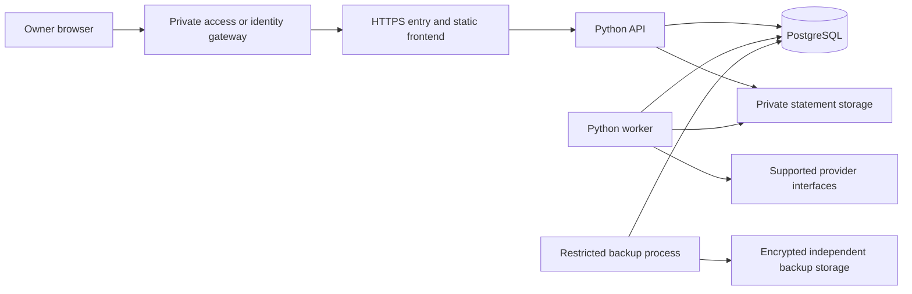

# Architecture

Planning baseline: 21 October 2026. Development uses local PostgreSQL; deployment uses Supabase PostgreSQL. The frontend prototype has locked dependency versions; the remaining components guide later implementation. Neither database is provisioned by the prototype.

## Components

| Component | Direction | Responsibility |
| --- | --- | --- |
| Web interface | React, TypeScript, Vite | Responsive dashboard and reviewed imports; production output served as static files |
| API | Python, FastAPI | Authentication, authorization, validation, financial queries, and connector coordination |
| Persistence | PostgreSQL, SQLAlchemy, Alembic | Exact stored values, constraints, transaction boundaries, and versioned migrations |
| Background work | A small Python worker with durable job records | Imports, price refreshes, retries, and reconciliation |
| Hosting | Oracle AMD VM, Docker Compose, Caddy | Application services, HTTPS, and constrained runtime resources |
| Hosted database | Supabase PostgreSQL | Managed database reached through restricted, verified TLS connections |

Keep domain modules for accounts, investments, banking, imports, valuations, and integrations within one application. This preserves clear boundaries without requiring separate services for each feature. No continuously running Node server is needed for the static frontend build. See [Vite deployment](https://vite.dev/guide/static-deploy.html) and [FastAPI](https://fastapi.tiangolo.com/).

## Data flow

The frontend accesses financial records through the API. It receives no database passwords, broker credentials, or administrative keys. The API and worker use restricted runtime roles. Administrative migrations and backups use separate identities.

## Environments and portability

- Development uses a local PostgreSQL instance bound to local/private interfaces and synthetic fixtures. Match the hosted PostgreSQL major version and required extensions once the Supabase project is selected.
- Automated checks use an isolated database, separate credentials, and fabricated or irreversibly sanitized fixtures.
- Hosted services use a dedicated Supabase project with the unused Data API disabled, source address restrictions, and certificate-verified TLS. See [security requirements](security.md).
- Application tables, business rules, and migrations remain ordinary PostgreSQL and Python where practical. Keep provider-specific authentication and storage adapters behind explicit interfaces.
- A future move between Supabase and self-hosted PostgreSQL requires a tested export, restore, roles/policies review, and cutover. It is not assumed to be only a connection-string change.

Supabase Free is the initial candidate. Its current limits include 500 MB database storage and pausing after inactivity; capacity and backup needs must be checked before deployment. Supabase manages infrastructure, but application permissions, schema, and security configuration remain shared responsibilities. See [pricing](https://supabase.com/pricing) and [responsibility model](https://supabase.com/docs/guides/deployment/shared-responsibility-model).

## Financial records

Model owners, institutions, accounts, instruments, transactions and cash movements, purchase lots, holdings snapshots, prices, exchange rates, import batches, source mappings, budgets, category rules, sync jobs, and audit events.

- Use PostgreSQL exact numeric types and Python decimal arithmetic for money, prices, rates, and fractional units. Specify scale and rounding rules for each operation; binary floating point must not be the accounting representation.
- Identify instruments with stable identifiers such as ISIN, exchange, and provider mappings. A display name or ticker alone is insufficient. Keep mutual fund scheme, direct/regular plan, growth/distribution option, and folio identity distinct.
- Preserve trade date, settlement date where supplied, source timezone, effective date, and import time. Store event timestamps consistently and display local time deliberately. A statement date is not an ingestion timestamp.
- Keep original currency amounts and fees. Store the date and source of each FX rate used for valuation. Historical cash flows require the relevant historical rates; current FX must not rewrite purchase history.
- Store holdings snapshots separately from transaction history. A changed snapshot is evidence for reconciliation, not permission to invent purchases or sales.
- Retain source identifiers, parser version, account mapping, and import batch metadata. Keep sensitive source documents outside the database with a controlled retention policy.
- Represent unknown basis, missing prices, and incomplete history explicitly. Report available coverage instead of substituting zero.
- Preserve buys, sells, dividends, withholding, fees, corporate actions, and transfers as distinct events. Define treatment and tests before enabling each calculation.

## Imports and reconciliation

Use a staged flow: receive, validate, parse in isolation, normalize, preview, confirm, commit, and reconcile. Only persist validated batches atomically. Rows requiring interpretation remain in review and must not silently affect holdings or balances.

File hashes detect exact reuploads. Provider transaction IDs and account-scoped source metadata support overlap detection. An amount/date/name match alone is not a unique transaction key: repeated purchases or bank payments can legitimately share those values.

Assign source precedence by account and data type. INDmoney and a CAS can describe the same mutual fund folio; provider snapshots must not create duplicate investments. Preserve conflicting evidence and require resolution rather than silently replacing history. Bank transfers need matched debit/credit legs, with cross-currency fees and conversion recorded separately.

Corrections must be auditable and reversible. Preserve the original imported event and record the correction or superseding version; prohibit unexplained destructive edits to committed financial history.

## Background processing and valuations

Persist job status, attempts, last successful result, and next retry. Claim work with database locking or leases, make writes idempotent, and keep concurrent import execution low on the AMD VM. Avoid a separate scheduler in every API worker. Retry transient failures with bounded backoff; expired consent requires renewal, not indefinite retries.

Holdings synchronization and market-data refresh have separate schedules and freshness indicators. Respect trading calendars, NAV publication dates, exchange timezones, provider limits, and delayed data. Keep dated valuation snapshots; recompute derived reports after reconciled corrections without losing their audit history.

XIRR, realized/unrealized returns, and portfolio performance require documented definitions and completeness checks. Treat deposits, withdrawals, dividends, fees, and corporate actions consistently. Do not infer cash-flow history from a current holding value or present these calculations as tax reporting.

## Database decision

Local PostgreSQL supports reproducible development. Supabase moves database infrastructure off the small Oracle server while retaining PostgreSQL compatibility. Independent backups and explicit access controls remain mandatory.

Self-hosted PostgreSQL remains an alternative if managed-service constraints become unsuitable. Oracle Autonomous Always Free uses Oracle Database and has restrictions on private endpoints and built-in restore, so it is not the selected database. OCI managed PostgreSQL is a billed service. See [Oracle Autonomous restrictions](https://docs.oracle.com/en/cloud/paas/autonomous-database/serverless/adbsb/autonomous-always-free.html) and [OCI PostgreSQL billing](https://docs.oracle.com/en-us/iaas/Content/postgresql/billing.htm).
