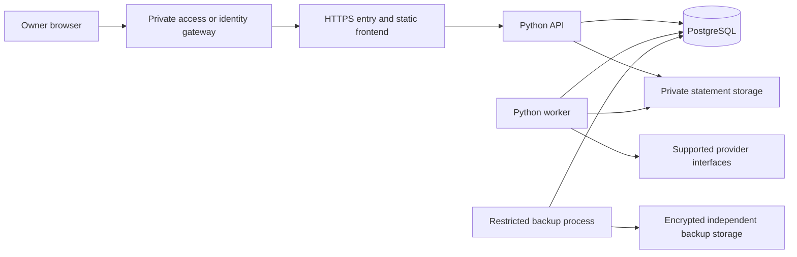

# Architecture

Implementation baseline: 21 October 2026. The current code and local checks use PostgreSQL and Supabase-specific authentication. The [5 November Oracle/Authelia decision](oracle-authelia-decisions.md) supersedes the hosted selection; the [migration plan](oracle-authelia-migration.md) separates target acceptance from current behavior. The frontend prototype has locked dependency versions and remains independent. [Step 3C](database-foundation.md) provisions local PostgreSQL 17 and migrations; hosted Supabase is not provisioned. The [Step 3 foundation plan](foundation-plan.md) defines implementation increments and security contracts. [Supabase Auth with FastAPI](authentication-options.md) is the currently implemented identity integration. The [Step 3A API scaffold](api-foundation.md) is implemented locally; identity/session integration and the Step 4 financial persistence services are implemented locally. [Saved investment review and connected views](reviewed-snapshots.md) are implemented. Hosted integration, live portfolio acquisition and current portfolio valuation remain outstanding.

## Components

Persistence, sessions and the data-flow diagram below describe the implemented system. Rows explicitly marked as targets require the migration acceptance gates; they are not active integrations.

| Component | Direction | Responsibility |
| --- | --- | --- |
| Web interface | React, TypeScript, Vite | Responsive dashboard and reviewed imports; production output served as static files |
| API | Python, FastAPI | Authentication, authorization, validation, financial queries, and connector coordination |
| Persistence | PostgreSQL, SQLAlchemy, Alembic | Exact stored values, constraints, transaction boundaries, and versioned migrations |
| Background work | A small Python worker with durable job records | Imports, price refreshes, retries, and reconciliation |
| Local packaging | Loopback Docker Compose with Nginx | Existing synthetic rehearsal; not a hosted stack |
| Target hosting | Ampere A1 worker, separate Swarm stack, Caddy ingress on AMD node 1 | Planned application release, HTTPS and bounded resources |
| Target database | Oracle Autonomous Database, subject to free-service compatibility | Planned exact persistence with tested database isolation and verified TLS |
| Target identity | Native Authelia OIDC with MFA | Planned verified issuer/subject identity; application retains authorization and opaque sessions |

Keep domain modules for accounts, investments, banking, imports, valuations, and integrations within one application. This preserves clear boundaries without requiring separate services for each feature. No continuously running Node server is needed for the static frontend build. See [Vite deployment](https://vite.dev/guide/static-deploy.html) and [FastAPI](https://fastapi.tiangolo.com/).

The local database tool is separate from API startup. Bootstrap owns the database; the migrator owns `app_meta` and `app`; runtime receives connection/schema usage and explicit owner-scoped privileges on the implemented preference and financial tables. Alembic runs in a verified, advisory-locked transaction. [Step 3D](ownership-isolation.md) adds internal owners, exact issuer/subject mappings, and constrained preferences. Forced row policies and parameterized transaction context enforce ownership; pool cleanup removes residual identity. [Step 3E.1](authentication-foundation.md) adds a separate identity-lookup role and a server-only Supabase password/TOTP service. [Step 3E.2](browser-sessions.md) adds opt-in browser routes backed by the same restricted authentication role, encrypted session state, durable admission, and append-only security events. Provider operations run between short database transactions, with exclusive renewal leases and revocation checks. [Step 3F.1](protected-workspace.md) integrates a separate protected frontend through the same-origin API. [Step 3F.2](display-preferences.md) adds authenticated preference reads and versioned writes using the restricted runtime role. A short session guard orders commits against application revocation, without holding database transactions during provider network work. [Step 4G.1](financial-reads.md) extends that boundary to account/source/instrument/position identity reads through bounded JSON POST queries. Financial mutations and connected views remain later work.

[Existing bank source assignments](bank-source-mappings.md) add a narrow protected mutation boundary over the existing account/source schema. Initial links, corrections and unlinks append immutable transitions, while exact retries retain their original predecessor and target. Bounded history and separate current-head checks preserve historical facts. No acquisition, schema, source-registration or financial-posting change is introduced.

## Data flow

The protected frontend uses the local API through the same origin; hosted delivery will require HTTPS, with opaque server-side sessions and no provider tokens in browser storage. Persistence includes owner identity, sessions/security events, non-financial preferences and the financial records introduced in Stage 4. Connected financial screens follow in Stage 5. A separate demo build retains fictional UI walkthroughs and never supplies fallback balances to the authenticated application.

The frontend accesses financial records through the API. It receives no database passwords, broker credentials, or administrative keys. The API and worker use restricted runtime roles. Administrative migrations and backups use separate identities.

## Environments and portability

- Development uses a local PostgreSQL instance bound to local/private interfaces and synthetic fixtures. The current PostgreSQL 17 implementation has no additional extensions; Oracle compatibility is evaluated separately through the migration gates.
- Automated checks use an isolated database, separate credentials, and fabricated or irreversibly sanitized fixtures.
- Oracle hosting requires a separate adapter, verified TLS, restricted network access and tested Oracle owner policies. The former Supabase checklist is retained as historical context; it is not the current deployment path. See [migration acceptance](oracle-authelia-migration.md) and [security requirements](security.md).
- Current persistence and migration history remain PostgreSQL-specific. Preserve portable Python domain contracts and introduce a separate Oracle baseline with equivalent tested invariants. Keep provider-specific authentication and storage adapters behind explicit interfaces.
- The selected cross-engine migration requires tested export/restore, equivalent database policies, identity preservation and deliberate cutover. PostgreSQL portability is not Oracle compatibility.

Under the superseded initial selection, Supabase Free was the candidate. Its current limits include 500 MB database storage and pausing after inactivity; capacity and backup needs must be checked before deployment. Supabase manages infrastructure, but application permissions, schema, and security configuration remain shared responsibilities. See [pricing](https://supabase.com/pricing) and [responsibility model](https://supabase.com/docs/guides/deployment/shared-responsibility-model).

## Financial records

The [Step 4 plan](financial-data-plan.md) defines the proposed account/source/instrument identities, exact numeric contracts, immutable evidence and corrections, atomic review completion, protected reads, and recovery coverage. [Step 4A](financial-values.md) implements pure Python value/date contracts and bounded exact arithmetic; [Step 4B](accounts-source-mappings.md) adds owned accounts, native currency membership, encrypted source identities and append-only mappings. [Step 4C](instrument-identities.md) adds owner-scoped instruments, listings, fund variants and account position identities with revisioned provider mappings. [Step 4D.1](import-staging.md) persists source observations, exact normalized candidate components and mapping-bound review history. Staged inclusion does not post financial movements. [Step 4D.2](financial-events.md) consumes a currently included row through a separate internal atomic event service, preserving exact components and distinct posted/pending native movements. [Step 4D.3](lot-evidence-corrections.md) separates acquisition/remaining lot observations and preserves event/lot correction, cancellation and reinstatement chains; effective reads exclude superseded movements. [Step 4E.1](snapshot-evidence.md) persists dated position/cash evidence and explicit selection without summing duplicate descriptions or fabricating movements. [Step 4F.3.2b](completion-receipts.md) adds a common atomic boundary for partial/unknown/snapshot import effects, explicit selections and immutable receipts. Exact retries resolve original receipts before live-state checks. [Step 4F.3.2c](reconciled-completion.md) requires exact source and combined equations before complete-activity statements can commit. [Step 4G.1](financial-reads.md) exposes protected identity projections. [Step 4G.2a](event-lot-reads.md) adds exact event/lot evidence and correction history through the same bounded read-only boundary. [Step 4G.2b](snapshot-market-reads.md) exposes snapshot/market evidence and explicit selection history/resolution. Connected portfolio views follow separately.

Model owners, institutions, accounts, instruments, transactions and cash movements, purchase lots, holdings snapshots, prices, exchange rates, import batches, source mappings, budgets, category rules, sync jobs, and audit events.

[Step 9 credit cards](credit-cards-plan.md) will add owned credit accounts, billing statements, liability movements and payment allocations. Keep liability balances distinct from assets and available credit, and match bank repayments without counting purchases twice as spending. Card-specific schema and routes are outside Step 4.

- Use PostgreSQL exact numeric types and Python decimal arithmetic for money, prices, rates, and fractional units. Specify scale and rounding rules for each operation; binary floating point must not be the accounting representation.
- Identify instruments with stable identifiers such as ISIN, exchange, and provider mappings. A display name or ticker alone is insufficient. Keep mutual fund scheme, direct/regular plan, growth/distribution option, and folio identity distinct.
- Preserve trade date, settlement date where supplied, source timezone, effective date, and import time. Store event timestamps consistently and display local time deliberately. A statement date is not an ingestion timestamp.
- Keep original currency amounts and fees. Store the date and source of each FX rate used for valuation. Historical cash flows require the relevant historical rates; current FX must not rewrite purchase history.
- Store holdings snapshots separately from transaction history. A changed snapshot is evidence for reconciliation, not permission to invent purchases or sales.
- Retain source identifiers, parser version, account mapping, and import batch metadata. Keep sensitive source documents outside the database with a controlled retention policy.
- Represent unknown basis, missing prices, and incomplete history explicitly. Report available coverage instead of substituting zero.
- Preserve buys, sells, dividends, withholding, fees, corporate actions, and transfers as distinct events. Define treatment and tests before enabling each calculation.

## Imports and reconciliation

Use a staged flow: receive, validate, parse in isolation, normalize, preview, confirm, commit, and reconcile. Only persist validated batches atomically. Rows requiring interpretation remain in review and must not silently affect holdings or balances.

File hashes detect exact reuploads. Provider transaction IDs and account-scoped source metadata support overlap detection. An amount/date/name match alone is not a unique transaction key: repeated purchases or bank payments can legitimately share those values.

Assign source precedence by account and data type. INDmoney and a CAS can describe the same mutual fund folio; provider snapshots must not create duplicate investments. Preserve conflicting evidence and require resolution rather than silently replacing history. Bank transfers need matched debit/credit legs, with cross-currency fees and conversion recorded separately.

Corrections must be auditable and reversible. Preserve the original imported event and record the correction or superseding version; prohibit unexplained destructive edits to committed financial history.

## Background processing and valuations

Persist job status, attempts, last successful result, and next retry. Claim work with database locking or leases, make writes idempotent, and keep concurrent import execution within measured application resource limits. Avoid a separate scheduler in every API worker. Retry transient failures with bounded backoff; expired consent requires renewal, not indefinite retries.

Holdings synchronization and market-data refresh have separate schedules and freshness indicators. Respect trading calendars, NAV publication dates, exchange timezones, provider limits, and delayed data. Keep dated valuation snapshots; recompute derived reports after reconciled corrections without losing their audit history.

XIRR, realized/unrealized returns, and portfolio performance require documented definitions and completeness checks. Treat deposits, withdrawals, dividends, fees, and corporate actions consistently. Do not infer cash-flow history from a current holding value or present these calculations as tax reporting.

## Database decision

Oracle Autonomous Database is the selected target, with Always Free conditional on actual service capabilities and security requirements. This replaces the Supabase hosting decision. Local PostgreSQL remains operational while the Oracle foundation is developed; a connection-string change cannot port its row policies, transactional DDL, advisory locks or recovery semantics. Preserve the applied PostgreSQL migration history and introduce a deliberate Oracle baseline.

The [compatibility inventory](oracle-authelia-migration.md#oracle-compatibility-inventory) records required replacements and unperformed probes. Independent encrypted backup/restore, bounded connections and restrictive network access remain mandatory. No paid service or automatic upgrade is part of this selection.

## Local packaging boundary

[Step 3G](local-packaging.md) builds the protected static assets and Python runtime into a non-root image. A restricted loopback HTTPS gateway shares a network namespace with the loopback-only API. Authentication remains unavailable in this fixed rehearsal entry point; database and authenticated behavior are exercised separately. The encrypted recovery drill reconstructs a fresh disposable schema from migrations, restores the [current durable application-record manifest](local-packaging.md#encrypted-foundation-recovery), and invalidates sessions. A distinct hosted configuration/role procedure and [Oracle/Authelia acceptance](oracle-authelia-migration.md) remain prerequisites for deployment.

[Step 4F.3.2c](reconciled-completion.md) adds exact source-period comparisons to atomic import completion. Immutable scope/input tables preserve both source and effective-ledger evidence. Conditional Python arithmetic and independent PostgreSQL membership/economic checks must both pass; the API and protected frontend remain unchanged.

[Step 4G.3a](import-review-reads.md) adds read-only source observations, normalized batches/rows and review histories. Row inspection validates the original normalized checksum and shares current mapping/status rules with persistence; completion remains a separate operation.

[Step 4G.3b](completion-receipt-reads.md) completes the persistence/read boundary with immutable receipt effects and frozen source/combined comparisons. Reads reconstruct one bounded historical comparison at a time under owner isolation; current portfolio calculations remain a separate data flow.

[Step 5A](amfi-nav-contracts.md) adds a pure, bounded public NAV parser and explicit target matcher. Original report bytes determine its digest; original line/occurrence, decimal strings and observation dates survive parsing. No automatic identity creation, provider request or database write occurs. [Stage 5](investment-flow-plan.md) defines the separate private document, review and connected portfolio boundaries.

[Step 5E.0](workspace-context.md) adds a non-authorizing session-context marker to checked session responses and requires it on preference and financial requests. Comparison happens after authentication and before financial SQL. A stale marker returns 412 without revoking the valid replacement session; client state is cleared before rechecking.

[Step 5B.1](parser-transport.md) defines a standalone standard-library framing contract for one bounded local parser request/reply. It accepts no owner IDs, paths or commands and has no successful parsed-data schema yet. Worker identity, isolation, provisioning and application authentication remain separate boundaries; the API package does not yet import or execute the transport.

[Step 5E.1](connected-accounts.md) connects a memory-only account directory to the existing protected account query. Requests bind to the checked sign-in; the client validates exact bounded pages, retains only the current page and cursor history, and clears records on workspace invalidation. It introduces no source connection, financial mutation or valuation.

[Step 6A.1](indmoney-integration-plan.md#implemented-discovery-boundary) adds standalone, credential-free INDmoney discovery validation. Fixed metadata destinations and bounded strict responses yield only advertised capability flags. The API package does not import this module or enable account authorization. Initial INDmoney compatibility now precedes remaining statement-parser work.
