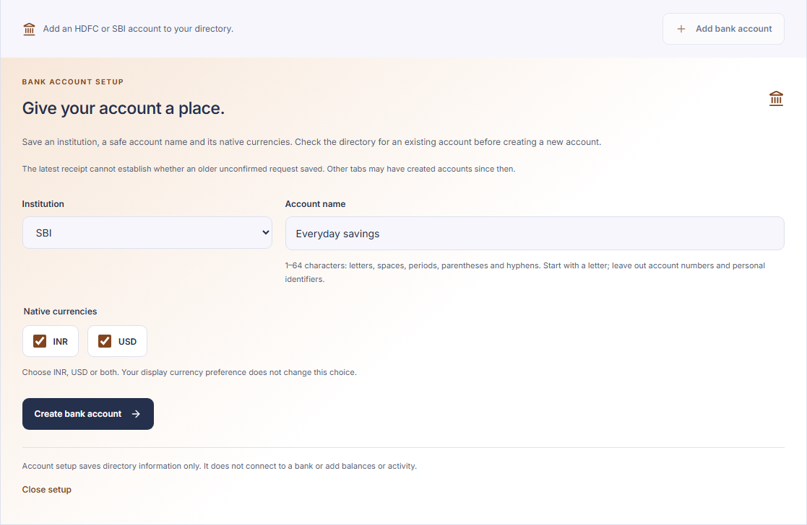
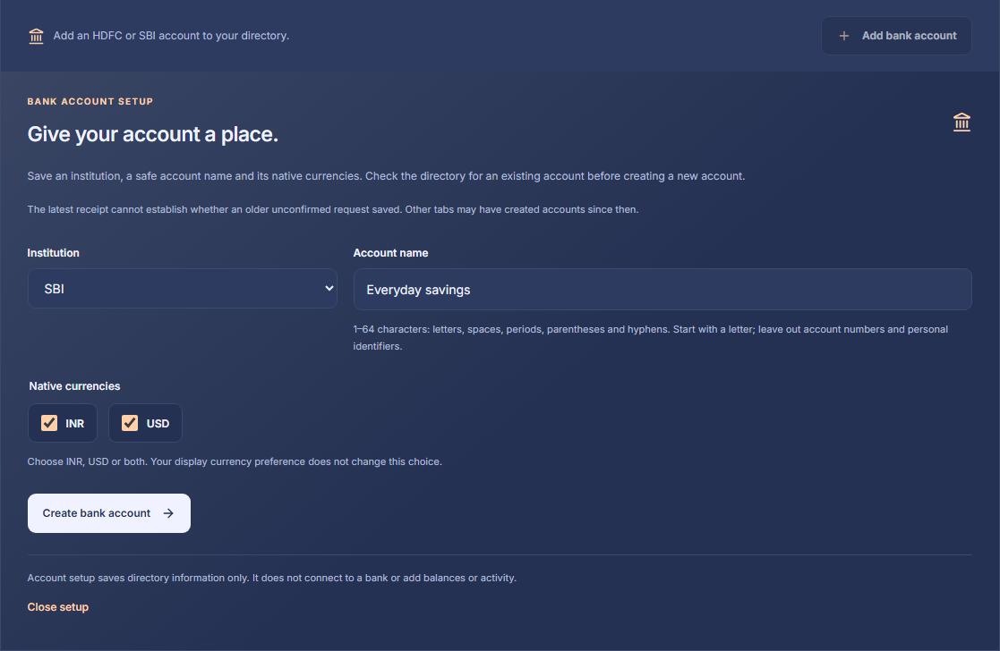
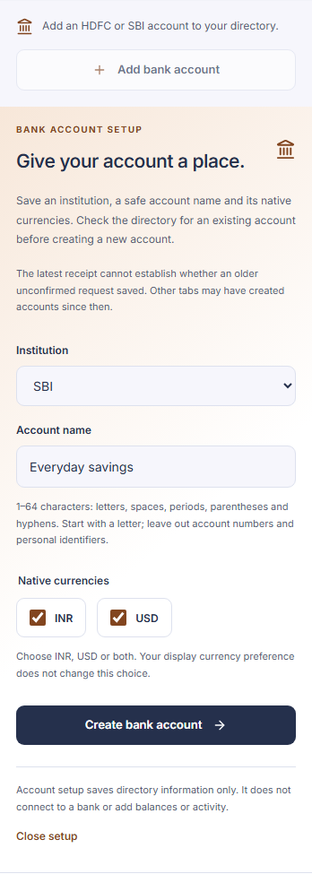
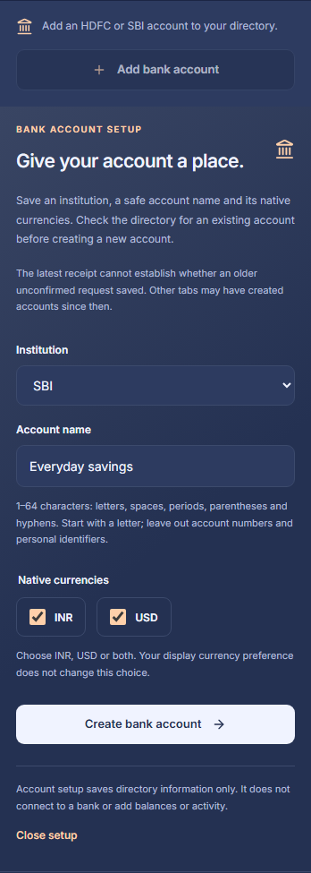

# Step 8B.1: Protected bank account setup

The protected Accounts page can create an owner-declared HDFC or SBI bank identity and refresh the saved account directory. A safe account name and explicitly selected native currencies are the complete declaration. Equal names can describe separate accounts.

This records a tracking identity. It does not verify bank ownership, connect to a bank, import records, create source mappings, or establish a balance. Account numbers, provider references and credentials are not accepted. Rename, archive, merge and acquisition controls remain separate features.

## Browser behavior

Opening setup checks the saved setup revision and refreshes the account directory. A review acknowledgment precedes the form, including after reload or navigation. The form accepts HDFC/SBI, a 1–64 character name starting with an ASCII letter and containing only letters, spaces, periods, parentheses or hyphens, and INR, USD or both. Display currency never changes native currency selection.

An explicit submission checks the setup revision again and prepares one random request identifier. The request, original revision and exact declaration remain immutable in component memory while saving. Duplicate clicks cannot start another submission. A successful response confirms the original creation and refreshes the existing paginated directory; the new account can appear on a later page.

If a response is unavailable, the request may have saved. An explicit retry repeats the same identifier, original revision and declaration. It never substitutes the latest revision or a fresh identifier. Conflict handling refreshes saved information and requires directory review before a separate new intent. The latest receipt alone cannot determine whether an older uncertain request saved when another tab has since created an account.

Reload, navigation and sign-in changes discard pending component state and never replay a mutation. There is no browser storage for account declarations, intents or tokens. The shared authenticated client validates the full response within its session-bound projection; local generation checks discard late payloads. Invalid transport or authentication responses retain the shared protected-shell boundary. Both themes retain visible keyboard focus, a focused state heading, ordinary form labels and touch-sized controls.

## Protected contracts

Both routes are same-origin bounded JSON POSTs beneath `/api/v1/finance/bank-account-setup`. They require the existing MFA browser session, CSRF token and workspace context. The owner is resolved exclusively by the server.

| Route | Request | Result |
| --- | --- | --- |
| `/query` | Empty object | Current setup revision and latest historical creation receipt; revision zero and a null receipt mean no setup receipts |
| `/create` | Canonical nonzero intent UUID, original expected revision, institution, name and canonical currency array | Immutable historical creation receipt with intent ID, resulting account ID, revision and original declaration |

Canonical currency arrays are exactly `["INR"]`, `["USD"]` or `["INR", "USD"]`. Reordering, duplicates, unsupported values, extra fields and unsafe names are rejected. Setup revisions are bounded by 1,000; creation receipts begin at one. A receipt revision is its command's original expected revision plus one.

Responses are checked against the route's declared model through bounded field extraction before serialization. Counterfeit model serializers, cycles, extra fields and malformed values cannot escape through an otherwise valid wrapper. Serialization and data failures stay within the financial error boundary; the final authorization check remains outside that handler and immediately precedes transaction commit. Data errors are private and responses are not cached.

## Durable retry and ownership

Migration `0024_bank_account_setup` adds `app.bank_account_setups`. Its immutable rows bind an owner-scoped intent to the original expected revision, declaration and resulting owned account. Account, native currencies and receipt commit together or roll back together. An aborted or stale attempt consumes no durable intent or setup revision.

The existing account advisory lock serializes setup decisions for an owner. Active ownership and read-committed isolation are checked after waiting for it. An existing committed intent is compared against its exact original head and declaration before current-head and quota checks. Matching retries return the original receipt even after later setup requests, account archival, currency additions or exhausted quotas. Changed reuse conflicts. New intents require the current head, and both setup receipts and financial accounts have 1,000-record owner limits. Names never deduplicate creation.

Setup queries use read-only financial transactions. The table has forced row-level security, owner-composite account and predecessor references, unique owner revision/intent/account constraints, a contiguous predecessor chain and runtime SELECT plus allowlisted INSERT columns. UPDATE and DELETE are rejected even for privileged restoration roles. Runtime insertion validates the active original account declaration and exact native currencies. Deferred restore validation binds the original institution/name and requires every declared currency to exist; it permits later archival and additional currencies without rewriting history.

The account advisory lock coordinates application account operations; it does not claim to serialize arbitrary administrator changes. Session revocation uses the existing registry guard, with a final authorization check before financial commit.

## Recovery and migration

Recovery format 20 retains the new receipt table alongside the existing durable records: 47 retained tables out of 51 application tables, with the same four live session/admission/connector tables omitted. The scalar canonical currency representation preserves the bounded recovery row grammar. Deferred predecessor references permit receipt reconstruction independent of export row order.

Recovery remains encrypted, schema-digest-bound and restricted to an empty destination, with one atomic restore transaction and new revocation cutoffs. Invalid original declarations, missing or incompatible owned accounts/currencies, broken predecessor chains and non-finite timestamps reject the restore. Original receipts remain replayable after a valid restore without comparing them to later account lifecycle. Formats 1–19 require their matching repository/schema before a forward upgrade; the current reader rejects them. A populated setup table blocks destructive downgrade.

## Verification boundary

Focused verification passed 87 pure Python setup/recovery-format tests, strict typing of the three new backend modules, 18 disposable PostgreSQL setup/migration/recovery tests, and 39 existing account/full recovery regressions. The first database run exposed a synthetic quota fixture missing its required native currencies; the fixture was corrected and the failure retained. Lint findings were corrected. Frontend verification passed 77 focused cases and 125 affected cases across six existing suites, TypeScript checks and both application builds. Full synthetic browser scenarios passed at 1440 and 390 pixels in both themes, including explicit review, exact retry, conflicts, navigation/reload, keyboard behavior, contrast, overflow and touch targets. At 320 pixels, checks covered initial review, invalid/valid forms and reflow in both themes. Visual review corrected stale validation feedback after input edits; the focused suite, type check, protected build and full browser matrix passed again. Initial dark/USD fixture errors and pre-correction captures are retained with the verification evidence. The public build reports the existing large-chunk warning. The full integrated repository gate remains separate; no hosted bank, Supabase or real account data has been used.

## Reviewed form examples

The captures contain synthetic account declarations.

| Desktop light | Desktop dark |
| --- | --- |
|  |  |

| Mobile light | Mobile dark |
| --- | --- |
|  |  |
