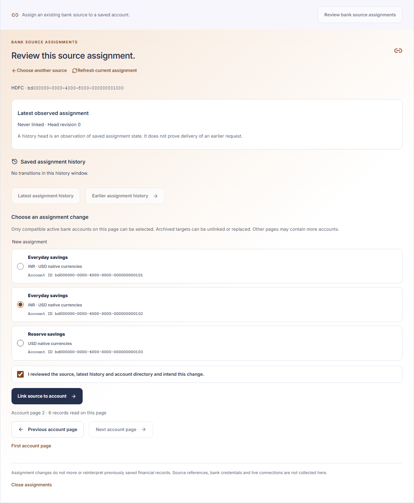
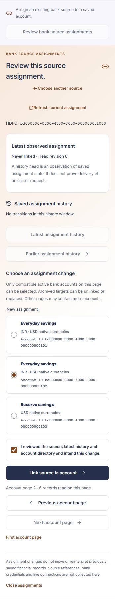
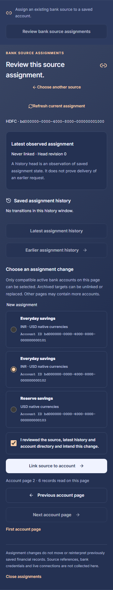

# Step 8B.2: Existing bank source assignments

The protected Accounts page can inspect and assign existing HDFC or SBI statement sources to an owned bank tracking identity. A source can be linked initially, corrected to another compatible account, or unlinked. Each accepted change appends an immutable mapping revision; previous revisions remain visible through bounded history.

This changes the source assignment used by later operations. It does not move existing financial records or rewrite their original source, mapping or account provenance. The interface does not register sources, accept account numbers or provider references, prove bank ownership, connect to a bank, establish balances, or import statements. Empty saved directories stay empty.

## Review and browser behavior

The source directory is validated as a complete response before the interface selects HDFC/SBI entries. Mixed pages and their pagination remain explicit. Choosing a source binds its UUID and immutable namespace to all later history and mutation responses. History shows the current head separately from the requested descending revision window; an empty earlier window does not mean the source has no mappings.

A new change requires an explicit target or unlink choice and a review of the resulting action. Eligible options and pending retry summaries display the internal Account ID so equal names and native currencies still identify distinct tracking accounts. Eligible targets are active, owned bank identities in India with the same institution as the selected source. Before a new submission the interface refreshes the current mapping and selected account page. A changed head returns the flow to review instead of silently replacing the original expected revision.

An unavailable response may still have saved. An explicit retry repeats the original source, expected predecessor and desired target unchanged. It does not substitute a newer head or target. A matching saved result is historical evidence of an equivalent transition, not evidence that this particular browser request caused it or that the assignment is still current. Starting a separate change requires fresh current information. Reload, navigation and sign-in changes discard pending component state and do not retry automatically.

Responses are validated inside the shared session-bound financial projection. The selected immutable namespace, exact query window, highest observed numeric head and equal-revision immutable head tuple are checked separately. A historical result cannot replace the current head. No declarations, mapping commands, financial values or tokens are stored in browser storage. Late responses and failed or changed-session views clear or discard protected state through the existing shell and component generation boundaries.

## Protected contracts

Both routes are bounded same-origin JSON POSTs beneath `/api/v1/finance/bank-source-mappings`. They require the existing MFA session, origin, CSRF and workspace-context checks. The server supplies ownership; neither route accepts an owner identifier.

| Route | Request | Result |
| --- | --- | --- |
| `/history` | Source UUID, optional page limit and exclusive `before` revision | Selected source scope, current immutable head, descending historical transitions and next cursor |
| `/change` | Source UUID, original expected revision and desired account UUID or null | One immutable saved transition |

A transition contains `source_id`, `namespace`, `revision`, `previous_revision`, `account_id` and a derived reason: `initial`, `correction` or `unlinked`. It carries no request attribution, current-status flag or account lifecycle projection. An empty head represents a known owned source with no mappings. The requested earlier window can also be empty with a nonzero current head, such as a query before revision one. Unavailable, foreign and unsupported sources use the same private conflict response.

The expected append revision is an integer from zero through 9,007,199,254,740,990. Stored revisions and history cursors are positive integers through 9,007,199,254,740,991 inclusive. Zero is reserved for a never-linked head. Boolean numbers, unsafe integers, extra fields, invalid UUIDs and invalid predecessor/reason combinations are rejected. Pages default to 25 entries and accept at most 100, using one additional SQL row to determine the next page.

The route validates the declared response model through bounded field extraction before serialization. Counterfeit serializers, malformed rows, cycles and extra fields fail privately. Serialization and local data exceptions remain separate from final authentication, context and limit checks. A valid response is serialized inside the financial transaction, then final authorization runs immediately before commit. Responses inherit the application's private, non-cacheable financial response policy.

## Transition replay and concurrency

Replay equivalence is the owner, source, original expected predecessor and desired account or null. It is not an intent UUID or attribution to one request. The service reads exactly the expected revision plus one and its exact predecessor. A saved successor is returned only when the entire derived state-changing transition matches. It never searches forward for a coincidentally matching current target.

Historical replay precedes current-head, active-target and quota admission. It remains available after later corrections, unlinking, account archival, currency additions or exhausted mapping quotas. New commands must change state: initial unlink and assignment to the already selected target are refused. Identical concurrent changes converge on the same saved transition; different targets using the same predecessor conflict. A stale or failed operation appends nothing.

The lock order is the session registry guard, the existing owner-scoped account advisory lock, then a compatible target account row locked `FOR SHARE`. That row lock conflicts with non-key archival updates and is held through financial commit. Ownership is checked in a fresh statement after advisory acquisition and after the target row wait. The target is read again after the wait, including when the locking statement returns no row. Admission requires read-committed isolation and an active same-institution bank identity. Historical replay does not require its old target to remain active.

The existing advisory lock coordinates application account and mapping operations; it does not serialize arbitrary administrator changes. Final session authorization protects successful financial commit. A failed data admission may return a private conflict before that final success-path check; it still rolls back and does not prove that the browser session remains valid.

## Persistence and recovery

The feature uses the existing `source_accounts` and `source_account_mappings` tables, owner isolation, immutable predecessor chain and 1,000-row mapping limit. The generic account mapping service remains unchanged for its other callers. No migration, recovery format, source-reference key handling, credential store or retention inventory is added.

Existing encrypted recovery retains the original source and mapping rows. Source-reference keys remain separately supplied for recovery; the new read/change routes do not decrypt references or handle those keys. Restored historical transitions retain the same exact replay semantics. A restore does not create a provider connection or establish source ownership.

## Verification boundary

Backend verification on the bank-setup baseline passed 118 pure contract, projection and protected-route boundary cases, strict typing of three new modules, and lint plus standalone formatting checks for five backend source/test files. The pure run retained quiet progress rather than a count summary; its 118 passing indicators are preserved. All 40 focused PostgreSQL and encrypted-recovery cases passed, including observed advisory/target/registry lock waits, current and no-row owner checks, final authorization rollback, historical replay after corrections and quotas, unchanged financial attribution and restoration with separately supplied reference keys. The first database run stopped after 26 passes on an inactive synthetic foreign-owner fixture; explicitly activating that fixture corrected the test setup, and its failed log is retained. Owned disposable databases and private test directories were removed.

The worktree then advanced over the independent NAV migration/recovery increment without changing the feature's source bytes. Final frontend verification on that baseline passed all 76 mapping cases and 264 affected cases across seven existing suites, TypeScript and both production builds. The earlier 67/258-case results are retained separately; they preceded the present-target family check and duplicate-name Account ID improvements. Logs retain existing jsdom canvas notices and the demo chunk-size warning.

Synthetic Chromium checks passed full interaction flows at 1440 and 390 pixels in both themes: mixed source/account paging, explicit links/corrections/unlinks, exact retry after later corrections and archival, independent current refresh, stale/conflict/protocol recovery, history pagination, native declarations with the USD display preference, and navigation/reload/session replacement without replay. At 320 pixels, checks covered initial directories, duplicate-target forms and reflow in both themes. Keyboard/focus behavior, 44-pixel controls, WCAG/contrast, document overflow and empty browser storage passed. All 92 captures were reviewed through contact sheets and eight representative originals; the preview/browser stopped and port 8048 closed.

These are synthetic local checks. The backend database run preceded the NAV schema advance; the final integrated repository gate verifies the combined tree separately. No live bank, provider, hosted authentication, credential or real statement was used, and source-format compatibility is not established.

## Reviewed form examples

The captures contain synthetic source and account identities. Full internal Account IDs distinguish equally named accounts.

| Desktop light | Desktop dark |
| --- | --- |
|  |  |

| Mobile light | Mobile dark |
| --- | --- |
|  |  |
