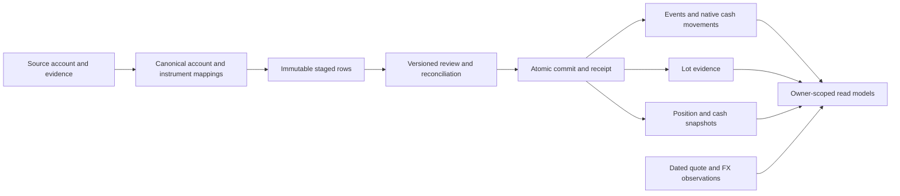

# Step 4: Financial data model and persistence

Status: [Step 4A exact value contracts](financial-values.md), [Step 4B accounts/source mappings](accounts-source-mappings.md), [Step 4C instrument identities](instrument-identities.md), [Step 4D.1 evidence/review staging](import-staging.md), [Step 4D.2 financial events](financial-events.md), [Step 4D.3 lot evidence/corrections](lot-evidence-corrections.md), [Step 4E.1 snapshots/selection](snapshot-evidence.md), [Step 4E.2 market evidence](market-evidence.md), [Step 4F.1 event evidence](event-evidence.md), [Step 4F.2 reconciliation contracts](reconciliation-contracts.md), and [Step 4F.3.1 statement boundaries](statement-boundaries.md) are implemented. [Completion through 4F.3.2c](reconciled-completion.md) is implemented. [Step 4G.1 identity reads](financial-reads.md), [4G.2a event/lot history reads](event-lot-reads.md) and [4G.2b snapshot/market reads](snapshot-market-reads.md) are implemented; 4G.3 import/receipt inspection and persistence acceptance remain planned. File imports, financial write endpoints and connected interfaces are not implemented. Security, exact values, provenance, and recoverability are the acceptance criteria.

## Result and scope

Build the owner-scoped PostgreSQL model and Python persistence services that the investment and banking flows can share. At completion, synthetic financial records can be staged, reviewed, committed atomically, read through authenticated endpoints, corrected with retained history, and restored without reviving sessions. Every displayed value must have an identifiable source and a known scope of completeness.

Cover Indian/US equities and ETFs, direct/regular mutual funds, UBS employee-share lots, and bank/broker cash evidence. Stage 4 provides storage and service contracts for these records. The first real parser and connected portfolio screen remain Stage 5; provider integrations remain Stages 6–7; bank parsers, transfer matching, categories, recurring review, and budget persistence remain Stage 8. [HDFC credit cards](credit-cards-plan.md) are a separate Stage 9; scheduled prices/FX, performance calculations, and automation remain Stage 10. No trade execution, tax calculation, upload endpoint, mailbox access, provider connection, public registration, or cloud deployment is introduced here.

Credit card account kinds, liability movements, billing cycles, dues and payment allocations are not added to Step 4. Keep account kinds and financial components explicit so a later migration can add liability semantics without treating every account as cash or an asset. Stage 9 reuses ownership, exact values, evidence, review, idempotency and recovery contracts, with its own schema and acceptance tests.

Use fabricated fixtures and disposable PostgreSQL. The existing demo remains separate; its types and sample rules are reference cases rather than the production schema. The protected frontend retains its current empty workspace until a later complete data flow is implemented. Real identities and financial documents are outside this stage. Hosted gaps in [Supabase readiness](supabase-readiness.md) remain unresolved by local persistence tests.

## Delivery increments

Each increment includes focused tests, updated documentation, a conventional commit on `dev`, and a PR into `main`. Steps 4A–4C, 4D.1–4D.3, 4E.1–4E.2 and 4F.1–4F.2 and 4F.3.1 are implemented; completion through 4F.3.2c, protected identity reads in 4G.1, event/lot history reads in 4G.2a and snapshot/market reads in 4G.2b are implemented. Step 4G separates identity queries, dated financial evidence, and import/receipt inspection into reviewable increments. Step 4E separates snapshots/selection from market evidence. Step 4F separates provider identity, reconciliation, and atomic completion so each persistence boundary has its own verification. Schema-changing increments include their own recovery-format update and restore tests; recovery is not deferred to the last increment.

| Increment | Deliverable | Acceptance evidence | Conventional commit |
| --- | --- | --- | --- |
| 4A | [Implemented exact financial value, currency, date, and missing-value contracts](financial-values.md) | Decimal strings round-trip exactly; floats, non-finite numbers, unsupported scales/ranges, invalid dates, and ambiguous timestamps fail; signs and rounding have independent examples | `feat(finance): define exact financial value contracts` |
| 4B | [Implemented canonical accounts, currencies, protected source accounts, and versioned mappings](accounts-source-mappings.md) | HDFC/SBI and Indian/US/UBS accounts remain distinct; several sources can describe one canonical account; private references have protected custody; archive preserves history; composite ownership checks and recovery pass | `feat(accounts): persist owned accounts and source mappings` |
| 4C | [Implemented instruments, listings, fund variants, provider identifiers and position identities](instrument-identities.md) | Same name/ticker cannot merge securities; direct/regular and growth/distribution variants remain distinct; positions at different accounts remain separate; identifiers and mapping revisions are constrained | `feat(investments): persist instruments and fund identities` |
| 4D.1 | [Implemented provenance, import batches, normalized staged rows, and versioned review decisions](import-staging.md) | Source observations are immutable; staged data cannot change financial state; row/account/owner mappings are checked; invalid/conflicting data remains blocked; revised evidence invalidates stale decisions | `feat(imports): persist source evidence and review staging` |
| 4D.2 | [Implemented typed investment events, quantity movements, and native cash movements](financial-events.md) | Buy/sell, subscription/redemption, dividends, fees/withholding, and cash movement contracts preserve independent components and dates; posted/pending state is explicit; invalid multi-row writes roll back | `feat(finance): persist investment events and cash movements` |
| 4D.3 | [Implemented sourced acquisition/remaining-lot evidence and auditable corrections](lot-evidence-corrections.md) | Purchase cost differs from reported tax basis; missing basis stays unknown; lot balances need supporting coverage; corrections preserve prior versions and cannot apply twice or branch concurrently | `feat(investments): preserve lot evidence and correction history` |
| 4E.1 | [Implemented dated position/cash snapshots and explicit source selection](snapshot-evidence.md) | Snapshots create no trades; duplicate descriptions are not summed; scope/coverage and date versus instant precision survive; conflicts block selection and corrections retain history | `feat(portfolio): persist snapshots and source selection` |
| 4E.2 | [Implemented quote/NAV and FX observations with explicit source selection](market-evidence.md) | Missing or unusable prices/FX stay unavailable; instrument/listing, direction, exact value, date precision and source freshness remain distinct | `feat(portfolio): persist quote and FX evidence` |
| 4F.1 | [Implemented protected provider identities and corroborating event evidence](event-evidence.md) | Scoped references reuse exact economics; legitimate repeats survive; altered payloads conflict; key rotation, source consumption and recovery remain safe | `feat(imports): preserve provider identities and event evidence` |
| 4F.2 | [Implemented exact source and combined-state reconciliation contracts](reconciliation-contracts.md) | Known opening/activity/closing values reconcile independently by native currency or position; incomplete coverage and exclusions cannot imply a balanced ledger | `feat(imports): reconcile source and combined financial evidence` |
| 4F.3.1 | [Implemented explicit source period boundaries and cash date basis](statement-boundaries.md) | Known checkpoint meaning, preserved historical digests, same-day conflict rules and encrypted metadata recovery | `feat(imports): preserve statement boundary evidence` |
| 4F.3.2a | [Implemented completion request contracts and owner-state guards](completion-preflight.md) | Private references omitted from canonical manifests; bounded state hashing, current owner isolation, serialized comparisons and rollback | `feat(imports): guard completion requests against stale state` |
| 4F.3.2b | [Implemented atomic completion for partial/unknown/snapshot evidence](completion-receipts.md) | Immutable receipts, current review/mapping/baseline checks, proven overlap, all-or-nothing effects, exact retries and encrypted recovery | `feat(imports): persist atomic review completion receipts` |
| 4F.3.2c | [Implemented reconciled completion and immutable comparison inputs](reconciled-completion.md) | Complete source and combined-state equations, exact native scopes and retained inputs; no partial-mode bypass for complete activity | `feat(imports): persist reconciled completion evidence` |
| 4G.1 | [Implemented protected account/source/instrument/position identity queries](financial-reads.md) | Active MFA and CSRF, owner isolation, strict bounded JSON pagination, explicit projections, archived/unmapped states, revocation, safe failures, restart and recovered API reads | `feat(api): expose protected financial identity reads` |
| 4G.2a | [Implemented event and lot evidence/history reads](event-lot-reads.md) | Exact native components, independent dates, current/historical versions, cancellation, bounded pages, two-owner denial and restored API evidence | `feat(api): expose event and lot history reads` |
| 4G.2b | [Implemented snapshot and market evidence/selection reads](snapshot-market-reads.md) | Dated quantities, quote/NAV and directed FX; selected/unselected/stale/conflicting states without inferred balances or valuation | `feat(api): expose snapshot and market evidence reads` |
| 4G.3 | Protected import/review/receipt inspection and persistence acceptance | Bounded lineage and immutable comparison inspection, historical retries, complete two-owner/recovery coverage and synthetic query measurements | `feat(api): expose import review and completion reads` |

Step **4A** provides exact value contracts. Step **4B** adds four owner-scoped tables and internal account/mapping services with key rotation and recovery. Step **4C** adds six instrument/position identity tables and versioned provider mappings. These increments add no route, seed data, provider access, or frontend change. Step **4D.1** adds five immutable evidence/staging/review tables without changing financial state. Step **4D.2** adds four exact event/component/movement tables and explicit posted/pending evidence. Step **4D.3** adds lot observations, exact monetary discount evidence and append-only event/lot corrections, cancellation and reinstatement. Step **4E.1** adds sourced snapshots, exact observation precision and explicit selection histories. Step **4E.2** adds exact quote/NAV and directed FX observations, corrections and explicit selection. Step **4F.1** adds protected provider identities and exact corroborating event links. Step **4F.2** adds exact source/combined-state equations with explicit coverage and missing evidence. **4F.3.1** adds explicit source period boundaries and versioned cash date basis. **4F.3.2a** adds strict completion manifests and serialized owner-state tokens. **4F.3.2b** adds atomic limited-coverage completion and immutable receipts. **4F.3.2c** adds full source-period reconciliation and persisted comparison inputs. **4G.1** adds protected identity reads; **4G.2a** adds event/lot evidence and history. **4G.2b** adds snapshot/market evidence and selection reads. Next is **4G.3** import/review/receipt inspection and persistence acceptance.

## Proposed records and relationships

Names below describe logical records; each increment determines the smallest concrete tables needed for its invariants. Keep typed columns for business-critical values and relationships. Unrestricted JSON payloads must not replace constraints.

| Record group | Identity and purpose |
| --- | --- |
| Canonical account and currency | Owner + opaque account ID; kind, institution label, lifecycle state, and supported native currencies. A bank account and brokerage cash balance are account evidence, not additional securities. |
| Source account and mapping | Owner + source namespace + protected external reference; explicit, versioned link to the canonical account. INDmoney, a CAS, and an advisor export may describe the same underlying folio. |
| Instrument, listing, identifiers | Owner-scoped instrument ID; asset class, identifier namespace/value, listing/exchange and quote currency when applicable. Fund scheme, direct/regular plan, growth/distribution option and holding form remain explicit. |
| Account position identity | Canonical account + instrument + holding form; listings do not duplicate a position, and a folio is represented by its account. Accenture at UBS and Accenture at INDmoney US are two positions in the same security. |
| Source observation and import batch | Source/account identity, source period/as-of, ingestion time, normalization/parser version, evidence digest, coverage and review revision. File metadata may reference a future private object; no file storage/upload is implemented here. |
| Staged row and decision | Stable source occurrence and immutable normalized candidate; bounded source fields needed for interpretation; decision/reason tied to the evidence and mapping revision. Staging is not a ledger entry. |
| Financial event and components | Stable event ID with immutable versions; typed quantity/cash legs, fees, withholding and source links. A current-version reference selects the effective record without destroying earlier versions. |
| Lot evidence | Account/position, acquisition or remaining-lot scope, quantity, supplied dates, acquisition amount, fees, and separately supplied basis with provenance/completeness. Unallocated history is explicit. |
| Position/cash snapshot | Scope-specific checkpoint, native units/amount, source timestamp precision and coverage. An explicit selection identifies the current evidence for a position or cash balance. |
| Quote/NAV and FX observation | Instrument/listing or currency pair, exact value, direction, observation date/time precision, source and freshness. Observations do not alter units or native transaction amounts. |
| Commit/correction receipt | Owner, affected batch/event, expected revision, reason, opaque affected-record references, outcome and time. Financial lineage is separate from sanitized authentication/security events. |

An institution/provider is not an ownership boundary. Initially keep instrument definitions and source mappings owner-scoped too; a shared market-data catalog can be introduced separately. Never merge accounts or instruments solely because their labels match. Missing or conflicting identity blocks the affected candidate instead of creating a guessed mapping. Enforce uniqueness only within a documented namespace and scope, with a deliberate policy for optional/null identifiers.

## Exact values and dates

Use strict Python `Decimal` values created from validated decimal strings, with PostgreSQL exact numeric storage. Financial JSON values are decimal strings accompanied by currency/unit context; floats, JSON number coercion, booleans, NaN/infinity, exponent notation, thousands separators, and excessive input length are rejected at the normalized boundary. A future parser may normalize a documented source format before this boundary while preserving its evidence. Normalize negative zero consistently without rewriting the original supplied representation.

Implemented Python bounds are project limits, not claims about provider export formats. Step 4D.1 enforces the relevant staged quantity, price, cash and monetary-evidence bounds in PostgreSQL too. Posted events and other record-specific constraints follow in their schema increments:

| Value | Fractional digits | Magnitude and interpretation |
| --- | --- | --- |
| Posted INR/USD cash or settlement amount | At most 2 | Absolute value below 10^18; signed movement into/out of its account |
| Supplied monetary evidence such as acquisition/basis totals | At most 8 | Absolute value below 10^18; currency and amount meaning required; not automatically a cash posting |
| Security/fund quantity | At most 12 | Absolute value below 10^18; signed movement or nonnegative long-position/lot snapshot according to kind |
| Unit price/NAV and FX rate | At most 12 | Positive and below 10^18; FX stores explicit base/quote direction |

Values exceeding the contract remain unsupported/review-required; never truncate a source to fit. INR/USD are the initial currency allowlist. Reported zero values retain their explicit evidence; absent fees/basis/prices use null plus an allowlisted reason, never a default zero. A source-reported zero or nonpositive quote can remain evidence without becoming a usable valuation quote.

Use PostgreSQL `numeric` with explicit finite, scale, range and kind checks for stored source values. A declared `numeric(p,s)` can round excess fractional input before a subsequent check sees it, so use constraints that reject excessive scale before any coercing cast; verify this using direct SQL as well as Python validation. Do not use PostgreSQL `money`, float types, or JavaScript Number for authoritative amounts. [PostgreSQL numeric behavior](https://www.postgresql.org/docs/17/datatype-numeric.html).

Arithmetic uses an explicit decimal context sized for the supported operands and bounded aggregate sizes, with unexpected inexact operations detected. Retain original booked/source amounts. Quantize only a documented derived output: the 4A display primitive uses half away from zero at the final INR/USD minor unit, matching the prototype's explicit rule. Source settlement values remain authoritative and are reconciled independently; quantity × displayed price need not reproduce a separately rounded settlement. FX inversion/division and allocation require their own precision and residual rules before use. [Python decimal contexts](https://docs.python.org/3.14/library/decimal.html).

Keep trade, settlement, booking and value dates separate when supplied. Use calendar dates for date-only evidence, not invented midnight instants. Store ingestion/audit instants as timezone-aware UTC and retain source timezone/precision when known. Unknown source timezone stays unknown; ambiguous dates/timestamps are not guessed. Settlement may legitimately follow trade/ingestion, so date ordering constraints depend on record kind and source meaning.

## Event, lot and snapshot rules

Financial events have a bounded set of supported kinds and validated components. A purchase adds units and normally debits native cash; a sale removes units and credits cash. Fee/withholding amounts carry explicit component roles. A dividend's gross, withholding and net are related evidence: do not count all three as independent cash credits. Reinvestment requires linked cash and unit evidence rather than inventing a free acquisition. Unknown fees keep relevant reconciliation incomplete.

Bank/broker cash credits and debits can be stored without claiming spending categories or matched transfers. Transfers between tracked accounts retain separate source legs; an investment funding transfer must not become performance or income by assumption. Matching, category changes, budgets and cross-currency transfer interpretation remain Stage 8. No global sum mixes currencies, units, cash movement and asset value.

Unsupported corporate actions, derivatives, shorts, and unexplained negative positions stay in review. Preserve their bounded source evidence without applying guessed ledger effects. Opening positions/cash can be explicit sourced checkpoints; missing history never becomes a fabricated acquisition. An incomplete event history can coexist with a valid sourced snapshot, with its limitations visible.

Store acquisition and remaining-lot observations as distinct scopes. A remaining-lot snapshot cannot recreate original acquisition quantity or prove complete disposal history. ESPP purchase amount, discount evidence where supplied, and reported tax basis stay separate. Stage 4 does not choose a tax-lot disposal method or calculate taxable gains. Unknown basis remains unknown even when quantity × current quote is available.

Committed economic values are immutable. Corrections append a version/supersession with reason, source linkage and expected current revision; switching the effective version is atomic. Cancellation/reversal treatment is explicit per event kind. Readers count only the effective version, and concurrent corrections cannot branch or double-apply. Restricted roles cannot rewrite/delete committed source/event rows directly; any mutable selection/status columns receive narrowly scoped privileges. Account archival preserves existing references.

Snapshots are evidence for a defined account/position/date and coverage scope. A refreshed snapshot never writes a synthetic purchase/sale. Multiple sources describing the same canonical position at the same instant are reconciled or explicitly selected, not summed. A source selection cannot resolve conflicting immutable quantities without recording a correction. Later partial snapshots do not imply zero for positions they omit. Distinguish full-account replacement coverage from a selected-position snapshot and distinguish same-day date-only evidence from an exact instant.

Quote/NAV and FX observations are stored separately from positions and event history. There is no downloader, scheduled refresh, portfolio-return engine or cross-currency aggregate in this stage. Reads preserve native currency, original dates, missing-value reasons and separate position/price/FX freshness. Display currency preferences must not rewrite stored economics.

## Review completion and deduplication

4D.1 stores normalized synthetic candidates through an internal service. 4F adds reviewed completion through a bounded internal service; upload/parse and browser mutation endpoints remain for their respective complete product flows. These services accept a trusted owner context, never a payload-supplied owner. Tests can invoke them with synthetic identities; no development bypass route or normal-startup seed is added.

Use immutable source observations and separate review state. A candidate follows staged → reviewable/blocked → committed, or an explicit rejected/superseded disposition. Every occurrence has exactly one current disposition. Reprocessing with a different normalization/parser version creates new evidence/review state, not a silent rewrite of committed rows. Decision changes use expected revisions and retained history; committed receipts are not erased by a prototype-style reset.

| Situation | Required result |
| --- | --- |
| Same owner, source and identical document evidence | Identify the replay; repeat completion returns the existing receipt and changes no financial totals |
| Same scoped provider identity and same economic payload | Link the additional evidence to the existing effective event, without adding another movement |
| Same identity with changed immutable payload | Preserve both observations and block the conflict; require an auditable correction |
| Same date/amount/description but distinct or missing identity | Preserve possible repeated transactions; similarity produces a review candidate, never automatic deduplication |
| Different vendors describing the same fund folio | Resolve canonical account/instrument/folio and evidence scope explicitly; vendor ID differences do not prove distinct holdings or trades |
| Same idempotency key with changed normalized request | Return a conflict; do not reuse a receipt for a different change |
| Two concurrent completions or corrections | Unique constraints and transaction locks/revision checks produce one effective change; the loser gets the stable prior result or a conflict |
| Failure after some rows are inserted | Roll back rows, source links, decisions, current selections and receipt together; retry cannot partially replay |

Scope document digests, provider identifiers, idempotency keys and uniqueness by owner and the applicable source/account/record kind. Never expose cross-owner duplicate existence. Source occurrence identity and canonical economic-event identity are different concepts; identical raw rows can still be distinct legitimate source occurrences. Record normalization/hash algorithm versions and compare exact canonical content in addition to a digest where identity conflicts matter.

Before commit, recheck ownership, mapping/evidence/review revisions, expected baseline state, supported kinds, required values, deduplication and scope-specific reconciliation inside the transaction. Serialize conflicting work for the affected account/position in a stable lock order. No file/provider I/O occurs while holding these locks. Use durable uniqueness for idempotency; process memory or a preliminary SELECT is insufficient.

Reconciliation covers both the supplied source scope and the proposed combined state. In INR/USD, supplied posted opening + credits − debits must equal supplied closing when coverage supports that equation; pending records stay separate. Unit reconciliation requires a known opening and supported complete activity. Missing checkpoints or unmatched fees cannot be hidden by row exclusion. Snapshot-only completion attests only to the selected checkpoint, never complete history or tax basis. Record compared values, rule version, coverage and the immutable review receipt so the result can be reproduced later.

## Ownership, privacy and API boundary

Every financial/source/review/receipt row carries a non-null `owner_id`; required parent references are non-null too. Referencing keys include owner and resource ID, with matching composite uniqueness/foreign keys, so an owned child cannot reference another owner's account, instrument, batch, event or snapshot. Index owner plus the relevant account/date/identity dimensions. Enable and force RLS with both read and write policies; keep runtime roles separate from schema ownership and retain transaction-local owner context and pool cleanup. Authentication-role access to financial tables remains denied. [Constraints](https://www.postgresql.org/docs/17/ddl-constraints.html), [row-security boundaries](https://www.postgresql.org/docs/17/ddl-rowsecurity.html).

Use opaque IDs and safe labels. Full bank/broker account numbers, folio references and sensitive source identifiers are not URLs, logs or browser storage. Retain only the source fields needed for reconciliation. Use owner-scoped keyed fingerprints for matching private external references; retain an encrypted reference only where recovery of that reference is necessary. Use maintained cryptographic libraries and a separately versioned financial-identifier key outside the database/image/session keys. [Step 4B](accounts-source-mappings.md#private-references-and-keys) implements key rotation, unavailable-key failure and separate key recovery for these references. Do not introduce PAN, addresses, statement binaries, provider credentials, or unrestricted raw payloads into these tables.

Queryable financial amounts remain protected by restricted database roles, RLS, access-controlled encrypted backups, and the verified TLS/storage controls required for hosted use. Do not claim the local database rehearsal provides production disk encryption. Security events contain only allowlisted event/outcome and opaque correlation references; detailed financial lineage stays inside owner-scoped records. Raw database/constraint exceptions must not reveal another owner's existence.

4G adds finite read models for accounts, instrument/position evidence, event history, lots and import receipts. Identity queries implement a default page size of 25 and maximum of 100; keep later pages bounded, stable ordering, bounded filters, indexed queries, and no unbounded export. Unknown and foreign IDs produce the same unavailable result. Use opaque pagination references and keep financial filter text out of URLs; any filter body has an explicit schema and size limit. Responses use decimal strings, native currency, source dates, completeness and null reasons. They must not label a snapshot-only value as a calculated ledger balance.

Step 4G.1 extends the existing authentication/preferences browser boundary to the complete financial route family. Later financial routers must stay inside it; merely registering a router is insufficient. Require active MFA, a valid non-revoked session, exact origin/host, bound CSRF and sanitized errors/no-store responses. Allow only the new route's documented pagination inputs without relaxing existing auth/preference query rejection. Check session/owner validity around database work; background reads must not extend idle lifetime. Add no normal financial write, provider download, or administrative endpoint in 4G.

## Migrations, recovery and verification

Start from migration `0005_preference_revisions`. Each schema increment adds a forward migration and tests fresh creation, upgrade with existing owners/preferences/sessions, repeated application, atomic failure, role grants and owner constraints. Do not modify previously shared revisions. Preserve existing preference revisions and authentication behavior. Development migrations create no synthetic owners or financial rows; data fixtures belong only in disposable tests. Destructive downgrades remain confined to disposable clusters.

The current [recovery format](local-packaging.md#encrypted-foundation-recovery) enumerates 40 application tables, including account/source, instrument/position identity, evidence/staging/review, event/component/movement, lot/correction, snapshot/selection, market evidence/selection provider event evidence and completion receipt tables and rejects uncovered schema. Every new table/column/revision must extend that format, its manifest/version and reconstruction order in the same increment. Classify every table as durable or explicitly reconstructible; do not remove the coverage check or silently omit staged decisions, provenance, corrections, mappings or receipts. Continue excluding sessions/provider state and writing revocation cutoffs.

An older encrypted object must either use a tested compatible reader or be restored with its matching repository/schema version and then upgraded through tested migrations. Never relabel a manifest or skip its digest/revision checks. Verify privately recovered identifier keys separately from the encrypted database object; wrong/unavailable keys cannot become blank identifiers. Keep export/restore and row limits bounded for the small synthetic exercise. General financial-volume backups, off-site retention, provider identity recovery and hosted deployment remain separate operational work.

Required evidence across Step 4:

- Independent examples for signed cash, fractional units, high-precision quotes/FX, rounding ties, overflow, null versus zero, timezone/date precision and serialization. Direct SQL must reject forbidden values too.
- Two synthetic owners for every table/service/API, including cross-owner foreign keys, reassignment, identifier/digest collisions, missing/disabled owner, failed SQL, cancellation and pooled connection reuse.
- Exact/overlapping imports, legitimate repeats, changed identifiers/payloads, source precedence, unknown fees/basis, missing positions, pending activity, stale review, concurrent commit/correction, crash/retry and partial-write rollback.
- Separate-cluster encrypted restore that compares financial rows, lineage, receipts, revisions, constraints, grants and RLS; validates key recovery and denies old sessions before reading restored data.
- Bounded query/pagination behavior and synthetic memory/query timing once representative records exist. The Step 3 locked-shell measurements are not financial-workload capacity evidence.
- Applicable local checks and all five CI groups on each final revision, with actual counts/results recorded in its PR. The protected frontend remains separate from financial fixture bundles. Personal financial data never enters logs, telemetry, Git history or CI artifacts; committed test fixtures are fabricated.

## Choices to revisit with source evidence

The implemented 4A contracts require no provider account or statement. Later parser work must verify actual account/folio identity rules, source transaction references, supported precision, historical coverage and lot semantics using sanitized representative exports. Values or identities outside the contract require a documented extension and tests before persistence. Statement retention, production key custody, hosted adapter/roles, private access, backup scale and operating cost remain on their existing checklists; this plan does not resolve them by assumption.
