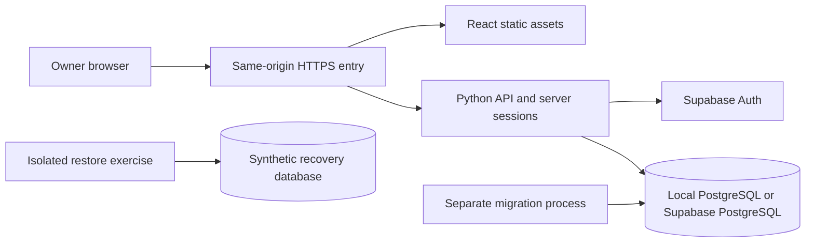

# Step 3: Secure application foundation

Historical implementation baseline: Steps 3A-3G describe the existing PostgreSQL/Supabase foundation. The [Oracle/Authelia decision](oracle-authelia-decisions.md) changes the target; its [migration increments](oracle-authelia-migration.md) preserve the security contracts below while replacing provider-specific behavior.

Status: Steps 3A–3G implemented locally; hosted evidence remains outstanding. Step 2 and the Step 3 planning PR #20 are merged into `main`. The [local API scaffold](api-foundation.md) provides a liveness endpoint, validated configuration, conservative server settings, and sanitized error/log handling. [Step 3B](verification.md) adds shared local checks and CI. [Step 3C](database-foundation.md) adds local PostgreSQL and the migration baseline. [Step 3D](ownership-isolation.md) adds internal owner isolation and forced row policies. [Step 3E.1](authentication-foundation.md) adds the internal Supabase authentication service and controlled identity mapping. [Step 3E.2](browser-sessions.md) adds browser sessions, revocation, recovery, and security events. [Step 3F.1](protected-workspace.md) adds the protected frontend shell. [Step 3F.2](display-preferences.md) adds authenticated display preferences. [Step 4](financial-data-plan.md) subsequently implements financial persistence and protected reads; [Step 6D](reviewed-snapshots.md) adds saved snapshot review and connected investment views. Hosted deployment remains unimplemented. Security is the first acceptance criterion.

The [authentication decision](authentication-options.md) selects Supabase Auth on Free with FastAPI. Python 3.14.9, uv 0.13.5, and the scaffold dependency tree are pinned. PostgreSQL 17.11, SQLAlchemy 2.1.6, Alembic 1.20.1, and Psycopg 3.3.6 are pinned in the database foundation. React, Indigo & Apricot, local PostgreSQL, and hosted Supabase PostgreSQL remain selected.

## Result and boundaries

Step 3 delivered MFA authentication, an initially empty protected workspace, saved non-financial display preferences, sign-out and locally tested recovery. The API and database independently enforce ownership. Development, automated tests, and a local production-style rehearsal use synthetic data.

These foundation increments excluded financial records and provider connectors. Subsequent stages implement [financial records and protected reads](financial-data-plan.md), [saved investment review and views](reviewed-snapshots.md), and [INDmoney authorization/custody](indmoney-authorization.md). Real statement ingestion, live portfolio acquisition and scheduled sync remain outstanding; trading and public registration remain outside the first version. The existing fictional prototype remains available as an explicitly separate demo build/entry point. A failed or empty API response must never fall back to demo balances. The authenticated build does not bundle demonstration financial fixtures. Stage 4 introduces real domain records; Stage 11 covers hosted rollout.

## Proposed increments

Steps 3A–3G below are implemented locally. Hosted rollout remains a later stage. Each delivers its tests, relevant documentation, a conventional commit on `dev`, and a focused PR into `main`. Larger findings are split further instead of combining unrelated capabilities.

| Increment | Deliverable | Acceptance evidence | Conventional commit |
| --- | --- | --- | --- |
| 3A — implemented | [Python API scaffold and safe configuration](api-foundation.md) | Locked Python/dependencies; clean install; loopback binding; minimal liveness endpoint; malformed/unsafe configuration fails closed; sanitized errors/logs; no financial or authentication bypass endpoint | `feat(api): add secure application scaffold` |
| 3B — implemented | [Repeatable local checks and CI](verification.md) | Python lint/type/tests and dependency audit, frontend checks, secret scanning, pinned actions with minimal permissions, synthetic isolated tests; no deployment credentials or production access | `ci(security): add foundation verification checks` |
| 3C — implemented | [Local PostgreSQL and migration baseline](database-foundation.md) | Reproducible local service, separate test database, explicit bootstrap/runtime/migrator identities; first schema migration and clean/upgrade/rollback-on-failure checks; runtime cannot perform DDL | `feat(database): add local postgres foundation` |
| 3D — implemented | [Ownership and database isolation](ownership-isolation.md) | Minimal owner/identity mapping and workspace-preference schema; non-owner runtime role; RLS for reads/writes; two-owner negative tests, missing identity denial, pooled transaction cleanup and rollback; no public data routes | `feat(security): enforce workspace ownership boundaries` |
| 3E.1 — implemented | [Supabase authentication and restricted enrollment](authentication-foundation.md) | Closed registration, explicit owner provisioning, verified primary identity and MFA enrollment/challenge; partial authentication grants no workspace access; secret-redaction and rate-limit tests | `feat(auth): add owner authentication and mfa` |
| 3E.2 — implemented | [Revocable sessions, recovery, and security events](browser-sessions.md) | Browser authentication routes, restart-safe admission limits, opaque cookies, CSRF/origin checks, bounded expiry, session rotation, concurrent renewal tests where applicable, logout/revoke-all, recovery/re-enrollment and outage tests; sanitized audit records | `feat(auth): harden session lifecycle and recovery` |
| 3F.1 — implemented | [Protected frontend shell](protected-workspace.md) | Matching light/dark login/MFA/expired-session UX, accessible keyboard/mobile states, empty workspace, no demo fallback, no provider tokens or cached financial data in the browser | `feat(ui): add authenticated workspace shell` |
| 3F.2 — implemented | [Authenticated display preferences](display-preferences.md) | Read/update allowlisted display preferences through the authenticated API and RLS; validation, concurrent update policy, rollback and session-expiry tests; no client-provided owner assignment | `feat(settings): persist protected workspace preferences` |
| 3G — implemented locally | [Local packaging](local-packaging.md) and [Supabase readiness](supabase-readiness.md) | Non-root application packaging, static frontend/proxy rehearsal, resource budgets, encrypted synthetic backup/restore, hosted compatibility checklist and explicit evidence gaps; no Oracle or production rollout | `chore(operations): prepare secure deployment foundation` |

3A records the selected Supabase Auth/FastAPI direction. 3B starts with available checks and gains real PostgreSQL tests in 3C–3D. 3D uses test-injected identities only inside the test harness; it exposes no development login route. 3E.1 adds a server-only authentication service and an interactive provider walkthrough; it introduces no HTTP login routes or browser sessions. 3E.1 and 3E.2 are both required before the frontend can access a workspace. Authentication tables and their limited session-lookup identity are introduced with the selected integration, rather than forcing premature provider-specific schema into 3C.

## Application and environment contract

Keep one Python application with explicit authentication, database, and domain interfaces. Start with one API process and a small bounded connection pool; no Redis, Celery, scheduler, or separate identity server on the AMD VM is required by this stage. Database transactions must be request-scoped, bounded, and closed on failure. External authentication calls have timeouts and do not hold a financial database transaction open. The [3G measurements](local-packaging.md#resource-evidence) cover the locked shell; authenticated workloads, imports, and Oracle memory/swap remain unmeasured.

| Environment | Database and identity | Boundary |
| --- | --- | --- |
| Local development | Local PostgreSQL with fabricated records. Selected authentication may use a local provider stack or a dedicated non-production identity project | Explicit configuration; loopback/private container network; never production credentials or owner records |
| Automated tests | Disposable PostgreSQL and deterministic identity adapter; real-provider contract tests are separate | No internet or hosted credentials required for normal test runs; no runtime option that enables a fake identity |
| Local production rehearsal | Locked built frontend/Python service through a local HTTPS gateway; cookie behavior and database roles tested separately; synthetic encrypted recovery | Loopback only; packaged hosted authentication/database integration remains unconfigured |
| Future deployment | Supabase PostgreSQL and selected identity provider; static frontend/API on Oracle | Dedicated configuration, verified TLS, private/gated entry, network restrictions, tested recovery; Stage 11 activation |

Step 3A pins Python 3.14.9, uv 0.13.5, and the compatible dependency tree. Step 3C selects PostgreSQL 17, a supported Supabase target, with no additional extensions. Verify the selected hosted project’s actual version and privileges before integration; local compatibility is not hosted evidence. Production must reject missing keys, debug/test identities, wildcard credentialed origins, insecure cookie settings, and unsafe database roles. Test commands must refuse non-test database names and hosted connection strings before destructive fixture cleanup.

## Ownership and schema contract

Create an internal owner identity independent of the authentication vendor. Bind it to a verified `(issuer, subject)` or equivalent local account identity using unique constraints and controlled provisioning. Never promote a login because its email matches a configured string, accept an `owner_id` header/body as authority, or provision a new owner during ordinary login. A disabled owner or unknown identity is denied. Test with a second synthetic owner from the beginning despite the personal-only UI.

Use an unexposed application schema. Separate bootstrap administration, schema ownership/migration, application runtime, session lookup, and later backup privileges. Runtime cannot own tables, bypass RLS, create roles, run migrations, truncate owner data, or impersonate the migration role. Grant only required operations, including sequences/functions; review default privileges and future objects. Authentication lookup has access only to the minimal identity/session records needed before ownership is established, not to portfolio tables.

For the Python-to-PostgreSQL path, the API validates the session first and binds its trusted internal owner to each database transaction. The implemented database interface uses a parameterized transaction-local setting; policies use that context for both `USING` and `WITH CHECK`. Missing/invalid context denies access, and it must not survive commit, rollback, cancellation, connection reuse, or retry. Supabase `auth.uid()` is not automatically populated by a direct Python database connection. Do not forward client claims into SQL context. [Transaction-local settings](https://www.postgresql.org/docs/current/functions-admin.html#FUNCTIONS-ADMIN-SET).

Step 3D enables and forces RLS on every current owner-scoped table, while keeping runtime roles separate from owners. Maintain these controls for future tables. RLS is not protection against arbitrary SQL execution with a trusted runtime credential: that credential can potentially set application context. Parameterized queries, restricted SQL surfaces, separate credentials, and prevention of role escalation remain essential. [PostgreSQL row security](https://www.postgresql.org/docs/current/ddl-rowsecurity.html).

Step 3 initially persisted owner/identity mapping, validated display preferences, session/renewal state and sanitized security events. [Step 4](financial-data-plan.md) subsequently implements owned financial tables and protected reads. Preserve UTC-aware audit timestamps, explicit nulls, bounded strings/enums and exact value contracts; financial API values use decimal strings with native currency and documented scale, never binary-float accounting values. App-only migrations must not alter Supabase-managed authentication schemas. Migration execution is a separate operation, never an automatic side effect of starting each API process.

## Authentication and session contract

Use [the selected Supabase Auth Free direction](authentication-options.md), then record its exact enrollment, factor, recovery, SDK, and development-test design before Step 3E. Use maintained protocol and cryptographic libraries. No home-built password, TOTP, JWT signing, or encryption algorithms. Public signup, anonymous accounts, and unneeded social providers stay disabled; initial owner provisioning is an administrative operation.

The implemented browser session is a random opaque identifier whose verifier is stored server-side. Hosted cookies use `Secure`, `HttpOnly`, a restricted path, no broad domain scope, and an appropriate SameSite policy. Prefer a `__Host-` cookie for the HTTPS application. A separately named loopback-only development cookie may be necessary; hosted configuration must reject that relaxation. Do not store provider tokens, passwords, MFA seeds, recovery codes, or session IDs in local storage, telemetry, URLs, or frontend bundles. Provider tokens retained by the backend require authenticated encryption and keys outside database/backups.

Implemented application limits: 15 minutes of inactivity, 8 hours absolute lifetime, and fresh authentication within 5 minutes for credential/factor changes. These are project defaults to validate against usability, not claims about a free provider tier. Background refresh/polling must not indefinitely extend the idle limit. Rotate the session after login and MFA changes; expire partial-authentication attempts quickly. The database-backed session state makes application logout/revocation effective on the next request. Reject sessions when the required identity/session store is unavailable. [Session guidance](https://cheatsheetseries.owasp.org/cheatsheets/Session_Management_Cheat_Sheet.html).

Protect every state-changing browser request, including login/logout and factor/recovery operations, with the selected framework's CSRF protection and strict origin validation. SameSite and CORS are supplementary controls. Use same-origin production requests and exact development proxy/origin settings; never wildcard origins with credentials. For redirected login, validate one-use state/nonce, PKCE, and fixed callbacks; allow only safe internal return paths. Do not return credentials in error responses. [CSRF guidance](https://cheatsheetseries.owasp.org/cheatsheets/Cross-Site_Request_Forgery_Prevention_Cheat_Sheet.html).

MFA enforcement belongs on the API, not just in the UI. Password recovery or factor replacement cannot silently produce a fully authenticated session. Enroll a tested secondary recovery method, require re-authentication for factor changes, revoke older sessions, and record a minimal security event. Audit event fields are type, outcome, time, correlation ID, and opaque actor/session references; no raw credentials, codes, bodies, or financial payloads. Sensitive endpoints have bounded attempts, payload sizes, and timeouts. Failed provider revocation must not restore a locally revoked session. Upstream revocation and refresh rotation require provider-specific integration tests.

## Frontend transition

Keep the existing visual system. Build clear sign-in, MFA enrollment/challenge, recovery-required, session-expired, forbidden, offline, loading, and empty states. Never flash protected content before the session check, render sample totals as live data, or cache protected responses in a service worker. Auth/private responses use `Cache-Control: no-store`; logout/session expiry clears in-memory user data and aborts or discards older requests. Password managers, paste into authentication fields, focus restoration, error summaries, and accessible status announcements must work.

The first saved feature is allowlisted theme/display-currency/masking preferences. Store no money or review decisions in browser persistence. Saved account choices take precedence after authentication; absent settings use system appearance, INR and masking enabled. Versioned saves require explicit reload after a conflict; masking must default conservatively after logout and never be mistaken for authorization. Existing prototype tests stay intact, with new API-contract and browser tests for the protected build.

## Supabase and recovery readiness

Use PostgreSQL over a direct connection when the network supports it, or the shared session pooler for an IPv4-only persistent backend. Keep a small application pool and bounded acquisition/query timeouts. Transaction pooling is not the default; adopting it later requires explicit prepared-statement, identity-context, and migration compatibility tests. Copy actual project endpoints rather than guessing hostnames. [Connection modes](https://supabase.com/docs/guides/database/connecting-to-postgres).

Require certificate and hostname verification (`sslmode=verify-full` with the appropriate trusted CA), no plaintext fallback, and source address restrictions for the chosen direct/pooler route. Keep application schemas outside exposed APIs; disable the unused Data API and verify grants to public/anonymous/authenticated/service roles. Database IP restrictions do not serve as application-login authorization. Do not pass service-role or administrative database credentials to the normal application. [TLS enforcement](https://supabase.com/docs/guides/platform/ssl-enforcement), [network restrictions](https://supabase.com/docs/guides/platform/network-restrictions), [Data API controls](https://supabase.com/docs/guides/api/securing-your-api).

[3G](local-packaging.md) provides a reproducible non-root build, restricted service filesystem/inbound networking, temporary TLS file injection, resource budgets, and a synthetic encrypted backup/restore rehearsal. Hosted application credential injection and outbound restrictions remain unimplemented. Preserve role/policy reconstruction and migration version alongside the backup; use separately recovered keys; verify owner isolation and row counts after restore. Revoke restored application sessions instead of resurrecting them. Supabase-managed identity recovery may differ from app-schema restore and needs its own tested procedure. See [operations](operations.md).

Real Supabase smoke tests require a dedicated non-production project, chosen region/version, verified plan features, and locally supplied credentials. Until those exist, record hosted TLS, network denial, grants, migration, pooler, and provider-recovery checks as **not run**. Local PostgreSQL tests cannot prove hosted configuration. This stage does not create a paid project, change cloud permissions, expose the app, or deploy the Oracle server. Free-tier pausing, backup limits, SMTP, and ongoing operating cost remain explicit constraints, not reasons to weaken required controls.

## Verification and completion evidence

| Risk | Required evidence |
| --- | --- |
| Account/session takeover | Wrong/expired/tampered credentials denied; mandatory factor checked; fixation, refresh races, logout/revocation, recovery, clock boundaries, and dependency outages tested |
| Cross-owner access | API and direct restricted-role tests deny other owners' reads/writes and attempted ownership changes; no identity denies; no pooled leakage after success/failure/cancel |
| Unsafe browser requests | CSRF/origin/CORS/host/callback negative tests; secure cookies; no-store responses; no user data after expiry/logout; keyboard/mobile auth review |
| Credential/data exposure | Logs, exception bodies, build artifacts, commits, and test output checked; scans and dependency findings reviewed; test adapters cannot run in hosted mode |
| Database corruption or privilege drift | Fresh/upgrade migrations, constraints, atomic failures, restricted-role inspection, foreign-owner relationships, and backup restoration tested on PostgreSQL |
| False deployment confidence | Local tests and hosted checks reported separately; actual target version, TLS, role grants, pooler behavior, restore limitations, and resource measurements recorded |

Optional manually dispatched CI uses read-only repository permissions, commit-pinned actions and no production secrets. Review the selected revision before dispatch; no privileged PR execution is enabled. Authentication-provider integration tests requiring secrets run separately on trusted code; local and optional manual checks use synthetic doubles and PostgreSQL. Security checks must not disappear silently through path filters or fail-open scripts. Branch protection configuration is a separate verified repository setting; adding a workflow alone does not enforce it.

## Decisions before their dependent increment

- Settled in 3A: Supabase Auth Free with FastAPI; Python 3.14.9 and uv 0.13.5. Provider integration remains later work.
- Settled in 3C–3D: PostgreSQL 17, local Docker services, separate role identities, guarded disposable test clusters, forced row policies, and transaction/pool identity cleanup.
- Settled in 3E.1: Supabase Free TOTP, password plus TOTP, explicit local owner provisioning, public-key JWT verification, and deterministic local provider tests.
- Settled locally in 3E.2: opaque cookies, signed CSRF and exact Origin, PostgreSQL admission/leases, AES-GCM with a separate local key, backup TOTP, and email-code recovery plus existing MFA. Hosted identity/email evidence and deployment key custody remain outstanding.
- Before hosting: region, domain/private entry, Supabase route/limits, backup destination and retention, key recovery, resource budget, and hosted evidence availability.

The local Supabase Auth/FastAPI foundation and [Step 4 financial persistence and protected reads](financial-data-plan.md) are implemented. The [investment flow plan](investment-flow-plan.md) records subsequent connected views and remaining acquisition/completion work. Hosted readiness remains tracked separately in the [checklist](supabase-readiness.md).
