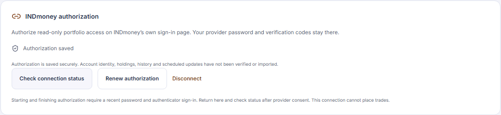
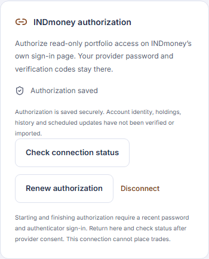
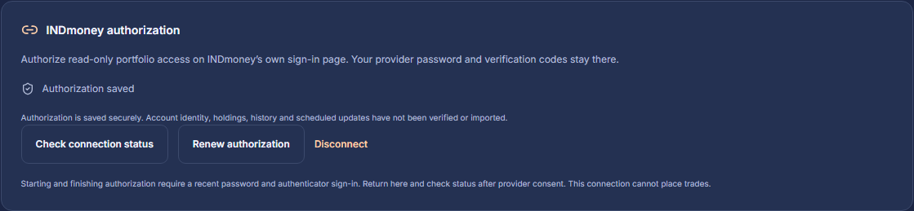
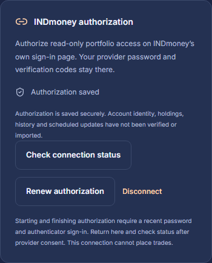

# INDmoney authorization and credential custody

Step 6B implements an opt-in authorization boundary for the registered local HTTPS callback. The protected workspace can start authorization, finish a returned code, inspect authorization status, request renewal and disconnect. All tests use synthetic provider responses. No owner has signed in to INDmoney through this application, and no holdings, transactions or trading capability are enabled. The remaining provider checks in [6A.2](indmoney-compatibility.md) stay open.

## Browser flow

1. Sign in to the protected workspace with password and MFA. Starting and finishing authorization require authentication admitted within the last five minutes. Requests bind the current session, signed CSRF value, exact Origin and workspace context; ownership never comes from the browser.
2. **Check connection status** reads local authorization metadata. An unconfigured server reports that setup is not enabled. **Continue to INDmoney** validates public discovery and requests only `portfolio:read`, using S256 PKCE and the fixed resource. The browser validates the returned destination before navigating to INDmoney. Passwords, MPINs, OTPs and TOTP seeds are entered only at the provider.
3. The callback accepts a bounded GET response at `https://127.0.0.1:8443/api/v1/connections/indmoney/callback`. A separate five-minute, Secure, HttpOnly, host-only Lax cookie binds the response to the initiating browser. The normal session and CSRF cookies remain Strict. No CSRF cookie is issued or replaced at this cross-site boundary.
4. A valid callback consumes the awaiting state by changing it to received and encrypting its code. It cannot exchange tokens or expose financial data. Success, denial, invalid input and internal failure all redirect to the same clean `/` URL, with no-store and no-referrer headers and deletion of the callback cookie. Provider error text is never returned or retained. The API and package access logs omit request URLs, queries, headers and bodies.
5. Back in the workspace, **Check connection status**, then **Finish authorization**. This same-origin POST must present the original active session and checked workspace context. A replacement sign-in cannot consume the earlier code. The server removes the attempt before exchanging the code; a failed or uncertain exchange is never automatically repeated.
6. **Authorization saved** describes encrypted token custody only. It does not assert a verified provider identity, account mapping, historical coverage, successful financial read or scheduled refresh. The UI explicitly retains those limits.

The attempt binds its owner, connection revision, initiating session, client registration, expected issuer/resource/callback, requested permission and PKCE verifier. State and browser-binding values are independently random 256-bit values; only their hashes enter PostgreSQL. Attempts expire after five minutes. Duplicate or unknown query fields, malformed encoding, non-navigation fetches, ambiguous cookies, substituted issuers, expired state and replay are rejected. The provider currently does not advertise the response `iss` parameter: a missing value is accepted only under that advertisement, with a dedicated issuer-specific callback and fixed token endpoint. A supplied issuer must always match; discovery that advertises `iss` makes it mandatory. See [OAuth security guidance](https://datatracker.ietf.org/doc/html/rfc9700) and the [MCP authorization contract](https://modelcontextprotocol.io/specification/2026-07-28/basic/authorization).

## HTTP contract

All routes are under `/api/v1/connections/indmoney` and exist only when the connector is supplied or explicitly enabled. The callback is the only cross-site exception. Other routes inherit strict same-origin JSON, CSRF, workspace context, query denial, duplicate-header checks and a 4 KiB request limit. Mutations accept only `{}`. The frontend keeps metadata in memory, discards late responses after locking/replaced sessions, and never stores tokens or authorization URLs in browser persistence.

| Method and suffix | Result |
| --- | --- |
| `GET` base path | Local status, whether this exact session can finish a callback, expiry metadata and `financial_access_enabled: false` |
| `POST /authorize` | Fixed provider authorization URL and transient callback cookie; does not grant access |
| `GET /callback` | Bounded provider response → fixed 303 redirect; no token exchange |
| `POST /complete` | Single-use code exchange → `authorized`, or a sanitized failure |
| `POST /refresh` | Explicit serialized renewal → `authorized`, or reconnection required |
| `POST /disconnect` | Local credential removal first; separately reports provider cleanup as confirmed, unavailable or not needed |

Normal connector conflicts and outages do not clear a valid application session. Authentication/context failures retain the existing lock behavior. The frontend never blindly retries a mutation after a timeout; check status first. There is no return-to URL, browser bearer token, dynamic registration route, arbitrary endpoint setting or order API.

## Provider transport and renewal

Public discovery still passes through the 6A.1 validator. Token and revocation requests use fixed INDmoney HTTPS endpoints, verified TLS, correctly form-encoded Basic client authentication, no ambient proxies, redirects, cookie forwarding or automatic retries. Each request has a ten-second overall deadline, shorter transport timeouts, a 32 KiB response ceiling and strict header/JSON checks. Unknown token fields, duplicate JSON keys, non-finite/coerced values, unsupported token types, missing expiry or permissions beyond the exact requested scope fail closed. The current narrow token contract requires an explicit `portfolio:read` scope and an integer lifetime of 1–86,400 seconds; live compatibility has not been established.

Five initiation/renewal admissions per owner and thirty globally are permitted in a rolling five-minute window, including failed attempts. Admission persists across restart. Four provider operations can run concurrently per service. Every database transaction is short; no provider request holds a database transaction or lock. A thirty-second connection lease serializes exchanges. Publication rechecks the lease, revision, original session, active owner and client binding under the same guard used by application revocation. Expiry is conservatively measured from before the exchange, so transport time cannot extend token validity.

An uncertain renewal clears local token custody and requires explicit reconnection. A crashed lease is never reused for another refresh; disconnect it before reconnecting. A missing replacement refresh token retains the prior token only after a fully validated successful response. This supports the OAuth response shape but does not prove INDmoney's rotation or reuse policy. There is no scheduler, backoff queue or unattended reader in this increment.

Disconnect clears encrypted local credentials and pending attempts before requesting provider revocation. It attempts revocation of both known refresh and access tokens. A non-success response, inaccessible key or in-flight issuance is reported as unconfirmed cleanup; local access stays disabled. A late exchange cannot republish after disconnect or session revocation, and newly returned tokens are submitted for best-effort cleanup. A provider accepting revocation requests is not evidence of immediate propagation. Existing saved authorization survives ordinary application sign-out, but cannot be used through these endpoints without a new verified session. Sign-out/owner revocation defeats operations already in flight.

## Encryption, database isolation and rotation

Migration `0018_indmoney_authorization` adds three private tables, for 43 application tables in total:

| Table | Boundary |
| --- | --- |
| `indmoney_connections` | One connection per owner; forced active-owner RLS, immutable owner/id grants, monotonic application revisions, encrypted tokens and bounded operation leases |
| `indmoney_attempts` | Trusted pre-owner callback registry; fixed owner/connection/session references, hashed correlation values, encrypted PKCE/code and five-minute expiry; session deletion cascades to pending attempts |
| `indmoney_events` | Append-only allowlisted event/outcome, database timestamp, internal owner and generated request ID; no provider/account identifiers, codes, tokens or payloads |

The existing restricted `trading_auth` role operates the security registry. It has no financial write access and cannot update/delete connector audit events or change connection ownership. The financial runtime role cannot access any of these tables. Arbitrary SQL with the trusted authentication credential is not an owner authentication interface. Explicit owner context is transaction-local and cleared on pooled connection return, including failures. Populated connector tables prevent destructive downgrade; existing financial records remain unchanged by upgrade.

AES-256-GCM uses fresh 96-bit nonces and an independent versioned key ring. HKDF purpose separation and authenticated context bind ciphertext to INDmoney, its issuer/resource/callback, the owner, connection, purpose and revision. Stored token content additionally binds the client registration. Application client credentials have their own application-level encryption context, since registration precedes owner authorization. They live in an encrypted local file rather than browser or database configuration. Supabase/session, financial identifier and backup keys are not reused.

Local keys are separately generated in `.cache/indmoney/keys/vN.key`; `client.sealed` contains the encrypted registration. Setup uses private directory ACLs on Windows and private permissions on Unix. Loading refuses missing/wrong keys, symbolic links/junctions, malformed configuration and unexpected key settings; startup never creates replacement keys. Encryption protects stored ciphertext, not a compromised running process or machine. Hosted KMS/Vault injection and independent off-site key custody remain deployment work.

To rotate, retain old and new independent keys in `TRADING_INDMONEY_KEY_VERSIONS`; the highest version becomes active. Re-encrypt the client file with `rotate-client`. The internal `IndmoneyDatabase.rotate` operation re-encrypts one owner's tokens and attempts atomically under the session guard and refuses an in-flight exchange. The database tests cover rotation and missing-key rejection. Do not retire old keys until every retained connection/attempt, including disabled owners, has been migrated or revoked. No key-deletion command is provided.

Audit events have the existing thirty-day development retention target. Cleanup is an explicit administrator operation; the application cannot delete audit rows. Expired attempts are pruned on new authorization, and deleting an application session removes its pending attempt. An idle installation still needs operational retention maintenance.

## Local setup

The connector defaults off. The locked container rehearsal remains unauthenticated and cannot enable it. For a later controlled local smoke test, first configure the dedicated Supabase test project, enrolled owner, session key and migrated local database using the [authentication runbook](browser-sessions.md). No such project or owner has been configured for this increment.

From `backend/`, using the pinned runtime:

```powershell
uv run --locked --no-sync python -m trading_connectors.local init-key --version 1
uv run --locked --no-sync python -m trading_connectors.local import-client
```

`import-client` requires a private interactive terminal and hidden input; it refuses to overwrite an existing encrypted client file. Supply only a deliberately managed registration for the exact callback above. The earlier 6A.2 DPAPI research registration remains separate and has not been copied, decrypted into this application or replaced by another registration. Reuse it through a reviewed local transfer before account testing; do not register duplicate clients or paste credentials into development conversations. Registration management/secret expiry remain unverified.

Install an independently managed browser-trusted local TLS certificate and matching private key in private `.cache/indmoney/tls/cert.pem` and `key.pem`. The certificate must cover `127.0.0.1`; the temporary package rehearsal certificate is not a persistent browser identity. Startup validates the key/certificate pair; do not bypass browser certificate validation. Rebuild the protected frontend, then set these non-secret process settings:

```powershell
$env:TRADING_API_PORT = '8443'
$env:TRADING_API_AUTH_ENABLED = 'true'
$env:TRADING_API_FRONTEND_ENABLED = 'true'
$env:TRADING_API_HTTPS_ENABLED = 'true'
$env:TRADING_API_INDMONEY_ENABLED = 'true'
$env:TRADING_INDMONEY_KEY_VERSIONS = '1'
uv run --locked --no-sync python -m trading_api
```

Only loopback HTTPS on port 8443 is supported for this connector. Hosted mode and arbitrary callback/issuer/resource settings remain unavailable. The entry point disables access logs, debug/proxy overrides and remote binding. No environment file is automatically loaded. There is no live-provider request until an authenticated owner starts an operation.

## Recovery and verification

Recovery format 14 explicitly excludes both live connector tables alongside application sessions/admissions. It retains connector audit records and all existing financial evidence. Restoring requires fresh application authentication and explicit provider reconnection; it cannot silently revive a token or pending code. Old format objects require the corresponding repository/schema before a forward upgrade; the current reader rejects incompatible manifests. Separately retained client keys/registration do not reauthorize an owner's account. Provider-side cleanup after disaster recovery remains a separate operator action.

Tests cover fixed permissions/destinations, strict callbacks and token responses, encryption context/tampering, ownership and grants, replay and replacement sessions, concurrent renewal, disconnect/logout/revoke-all during exchange, missing keys, durable admission, migration preservation and recovery with no live connector state. The full project checks use synthetic identities and provider doubles, never live INDmoney or Supabase credentials. Browser verification covers desktop/mobile light/dark modes, keyboard completion, contrast/accessibility, uncertain revocation feedback, no overflow/storage and clearing on lock.

| Desktop | Mobile |
| --- | --- |
|  |  |
|  |  |

The screenshots show synthetic authorization metadata. Live code exchange, granted-scope behavior, real refresh/rotation/reuse, provider revocation, account identity and history remain unverified. [Step 6C](indmoney-reader.md) implements the bounded reader engine with synthetic contract tests; its live adapter remains unavailable until authenticated schemas and source semantics are verified. Authorization alone does not establish identity or coverage. Financial reads/imports and scheduling remain disabled until their own source contracts and acceptance are complete.
